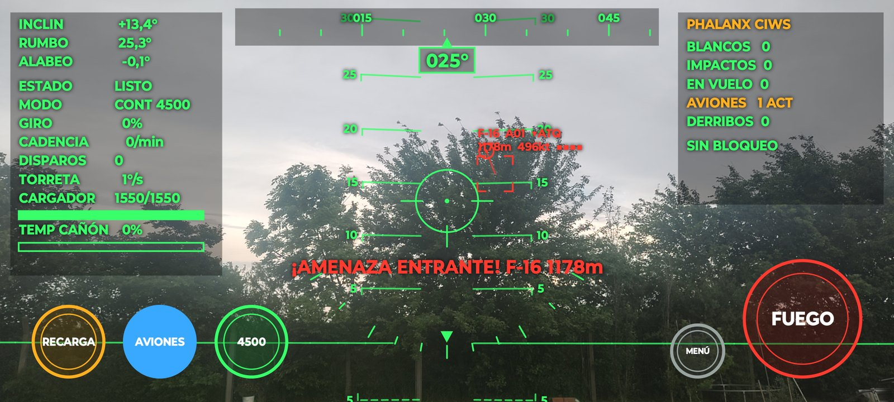
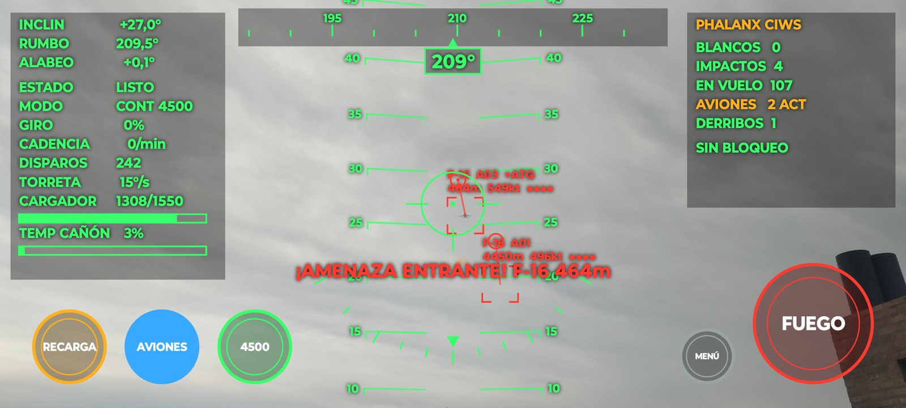
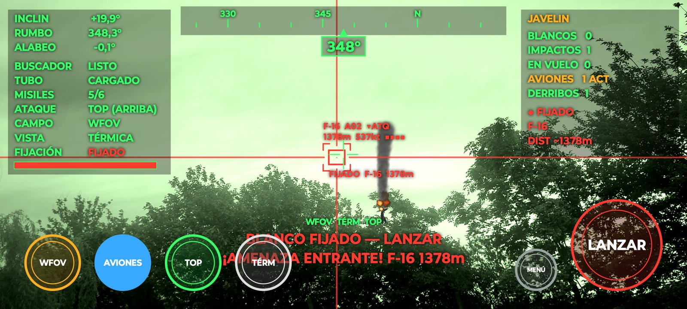
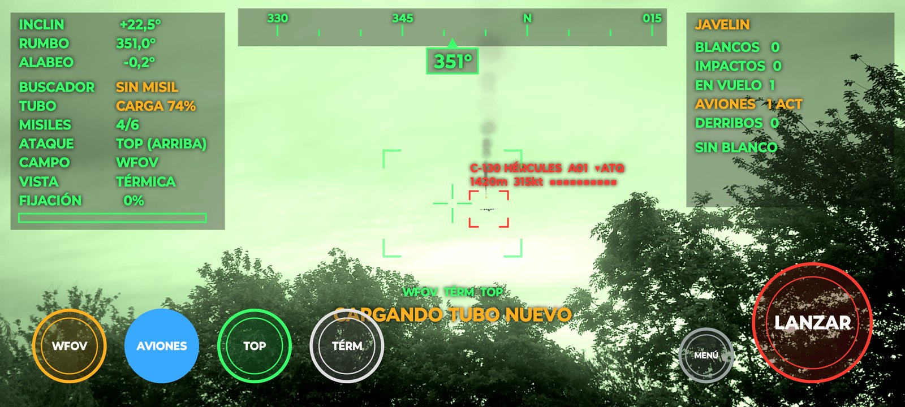

# Ayuda — cómo leer la pantalla

Capturas reales del juego en un celular, con lo que significa cada parte del HUD.

---

## Phalanx CIWS — amenaza entrante

- **Panel izquierdo:** inclinación, rumbo y alabeo del celular. Debajo, el estado del cañón (**LISTO**), el modo
  (**CONT 4500** = continuo a 4500 disparos/min), el giro del rotor, la cadencia medida, los disparos hechos,
  la velocidad de giro de la torreta, el cargador (1550 tiros) y la temperatura del cañón.
- **Arriba al centro:** cinta de rumbo y caja con el rumbo actual (**025°**).
- **Escalera de 5 en 5°** (10, 15, 20, 25…): está anclada al cielo real; al apuntar más arriba de 10° aparecen aviones.
- **Recuadro rojo con "F-16 A01 ▼ATQ":** avión en **pasada de ataque** (viene directo hacia vos), con distancia,
  velocidad en nudos y vida (■).
- **Círculo pequeño unido al avión por una línea:** la **retícula de adelanto**. Hay que apuntar **ahí**, no al avión,
  para que las balas lleguen a donde va a estar.
- **"¡AMENAZA ENTRANTE!":** parpadea cuando un avión de ataque está a menos de 2,5 km.
- **Panel derecho:** blancos detectados por la cámara, impactos, proyectiles en vuelo, aviones activos y derribos.
- **Botones:** RECARGA · AVIONES (encendido = azul lleno) · **4500** (modo de fuego) · MENÚ · FUEGO.

## Phalanx — disparando con adelanto

- Dos contactos a la vez (**A01** y **A03**); cada uno con su retícula de adelanto.
- **EN VUELO 107:** proyectiles que todavía están en el aire, fijos al entorno aunque muevas el celular.
- **IMPACTOS 4 / DERRIBOS 1:** cada avión aguanta varios impactos (los ■ muestran la vida que le queda).
- **TORRETA 15°/s:** velocidad a la que estás girando; el Phalanx real llega a ~115°/s.

---

## Javelin — blanco fijado (visor térmico)

- **Vista TÉRMICA** (botón TÉRM): imagen monocroma verdosa, como el visor de la unidad de comando.
- **Cruz roja de borde a borde + "FIJADO F-16 1378m":** el buscador fijó el blanco; ya se puede **LANZAR**.
- **Panel izquierdo:** BUSCADOR (LISTO / ENFRIANDO), TUBO (CARGADO), MISILES (5/6), ATAQUE (**TOP** = cae desde
  arriba), CAMPO (WFOV = sin zoom), VISTA y la barra de **FIJACIÓN**.
- **Columna de humo:** restos de un avión derribado antes (DERRIBOS 1).
- **Botones:** WFOV/NFOV (zoom) · AVIONES · TOP/DIR (modo de ataque) · DÍA/TÉRM (visor) · MENÚ · LANZAR.

Para fijar: poné el blanco dentro de la **ventana** (las 4 esquinas del centro) y mantenelo ~1,4 s. Los pitidos se
aceleran mientras fija y pasan a un tono continuo cuando queda **FIJADO**.

## Javelin — misil en vuelo

- **Estela de humo:** el misil ya salió y vuela solo hacia el blanco ("dispara y olvida").
- **EN VUELO 1**, **TUBO CARGA 74%**: mientras tanto se está cargando el tubo siguiente (4 s) y el buscador
  muestra **SIN MISIL** hasta que termine.
- **Ventana vacía (esquinas verdes):** lista para buscar el próximo blanco cuando el tubo esté cargado.
- **C-130 HÉRCULES ▼ATQ:** aguanta más impactos que los cazas (barra de vida larga), pero un Javelin lo derriba.

---

## Preguntas frecuentes

- **¿Por qué no aparecen aviones?** Encendé **AVIONES** y apuntá más de 10° sobre el horizonte. El primero aparece a
  los 2 s y después cada 10 s.
- **No veo el avión:** buscá la **flecha roja** en el borde de la pantalla, que señala hacia dónde está.
- **¿Cómo vuelvo a elegir arma?** Botón **MENÚ** o el gesto de atrás.
- **El volumen:** con las teclas de volumen del celular.
- **Instalar una versión nueva:** en *Releases* del repositorio, bajá el `.apk` con el número más alto.
